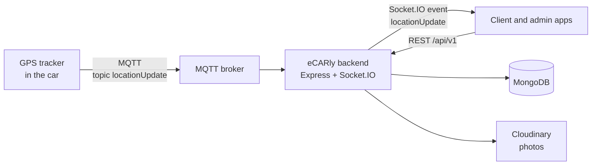

<h1 align="center">eCARly: car rental backend with live GPS tracking</h1>

<p align="center">
  A REST API for a car rental service: cars, bookings without double-booking, reviews,
  favorites and statistics, plus live car positions received over MQTT and pushed
  to the apps with Socket.IO.
</p>

<p align="center">
  
  
  
  
  
</p>

## Overview

eCARly is a second-year team project (2CP) at the Higher School of Computer Science of Sidi Bel Abbès (ESI-SBA), 2024–2025: a car rental service where each car carries a GPS tracker. This repository is the **backend**: it stores the cars, users and bookings, decides which dates a car can be booked, and relays each car's position from its tracker to the apps in real time.



## Features

**Cars**

- Catalogue with brand and model, colours, fuel type, transmission, seats and doors, options, daily and monthly rates, photos and status
- Filtering, sorting, field selection and pagination on every list (`?fuelType=diesel&sort=dailyRate&page=2`)
- Ready-made queries: the 5 cheapest cars, and the number of cars in total and in service
- Average rating and number of reviews, updated with each review

**Bookings**

- Availability check for a date range, and the list of a car's unavailable dates for the calendar
- No double-booking: only approved and ongoing bookings block a car
- Statuses: pending, approved, ongoing, rejected, cancelled, completed; customers can cancel their own
- Monthly and yearly booking statistics for the admin dashboard

**Live tracking**

- The server subscribes to the `locationUpdate` MQTT topic; each message (`carID`, `latitude`, `longitude`, a low-battery flag) is broadcast to connected apps as a Socket.IO `locationUpdate` event with a timestamp
- If no position arrives for 3 minutes, the apps receive an `mqttInactivity` alert
- An admin connection is authenticated with a shared secret, and the apps are told when a client disconnects or reconnects

**Users**

- Sign-up with a driving licence photo, login and logout with a JWT in a cookie, forgotten password and reset by email, password change
- Profile with photo, account deletion, and user management for admins
- Welcome and password-reset emails from Pug templates
- Favorites and reviews per car

**Security**

- Helmet headers, protection against NoSQL injection and XSS, 10 KB limit on request bodies, roles (`user`, `admin`), and a single error handler with clean messages in production

## Tech stack

| Area      | Tools                                                       |
| --------- | ----------------------------------------------------------- |
| API       | Node.js, Express                                            |
| Database  | MongoDB with Mongoose                                       |
| Real time | MQTT (`mqtt`), Socket.IO                                    |
| Auth      | JSON Web Tokens, bcrypt                                     |
| Files     | Multer, Sharp, Cloudinary                                   |
| Email     | Nodemailer, Pug templates                                   |
| Security  | Helmet, express-mongo-sanitize, xss-clean                   |

## Getting started

**Requirements:** Node.js and a MongoDB database (local or Atlas).

```bash
git clone https://github.com/ay-boutera/2CP.git
cd 2CP
npm install
# create config.env (see below), then:
npm run dev        # with nodemon; or: npm start
```

The server listens on `PORT` (8800 by default) and connects to the public test broker `mqtt://test.mosquitto.org:1883`.

### Configuration

Settings are read from `config.env` at the project root (ignored by Git).

| Variable                                                                    | Purpose                                                        |
| --------------------------------------------------------------------------- | -------------------------------------------------------------- |
| `NODE_ENV`, `PORT`                                                          | `development` or `production`; HTTP port (default 8800)        |
| `DATABASE`, `DATABASE_PASSWORD`                                             | MongoDB connection string, with `<PASSWORD>` replaced by the password |
| `JWT_SECRET`, `JWT_EXPIRES_IN`, `JWT_COOKIE_EXPIRES_IN`                     | Login tokens                                                   |
| `EMAIL_HOST`, `EMAIL_PORT`, `EMAIL_USERNAME`, `EMAIL_PASSWORD`, `EMAIL_FROM` | SMTP in development                                           |
| `SENDGRID_USERNAME`, `SENDGRID_PASSWORD`                                    | SendGrid in production                                         |
| `CLOUDINARY_CLOUD_NAME`, `CLOUDINARY_API_KEY`, `CLOUDINARY_API_SECRET`      | Photo storage                                                  |
| `ADMIN_SECRET`                                                              | Authenticates the admin's Socket.IO connection                  |

## API

Base path: `/api/v1`.

| Resource    | Routes                                                                                                                         |
| ----------- | ------------------------------------------------------------------------------------------------------------------------------ |
| Users       | `POST /users/signup`, `/users/login`, `/users/check-email`, `/users/forgotPassword`; `GET /users/logout`; `PATCH /users/resetPassword/:token`, `/users/updateMyPassword`; `GET /users/me`; `DELETE /users/deleteMe`; admin CRUD on `/users` |
| Cars        | `GET, POST /cars`; `GET, PATCH, DELETE /cars/:id`; `GET /cars/top-5-cheap`, `/cars/car-stats`                                    |
| Bookings    | `GET, POST /bookings`; `GET /bookings/my-bookings`, `/bookings/check-availability/:carId`, `/bookings/unavailable-dates/:carId`, `/bookings/monthly-stats`, `/bookings/yearly-stats`; `PATCH /bookings/cancel/:id` |
| Reviews     | `/reviews` and `/cars/:carId/reviews`                                                                                          |
| Favorites   | `/favorites` and `/cars/:carId/favorites`                                                                                      |

## Project structure

```
server.js            # loads config.env, connects MongoDB, starts HTTP + Socket.IO + MQTT
App.js               # Express app: security middleware, routes, error handler
serverMQtt.js        # MQTT subscriber and Socket.IO relay (positions, inactivity alerts, admin)
controllers/         # auth, users, cars, bookings, reviews, favorites, errors
models/              # Mongoose schemas
routes/              # Express routers
Utils/               # query features, availability service, email, Cloudinary, Multer
views/email/         # Pug email templates
```

## Team

Second-year team project at ESI-SBA. Backend by [Boutera Ahmed Yassine](https://github.com/ay-boutera).
